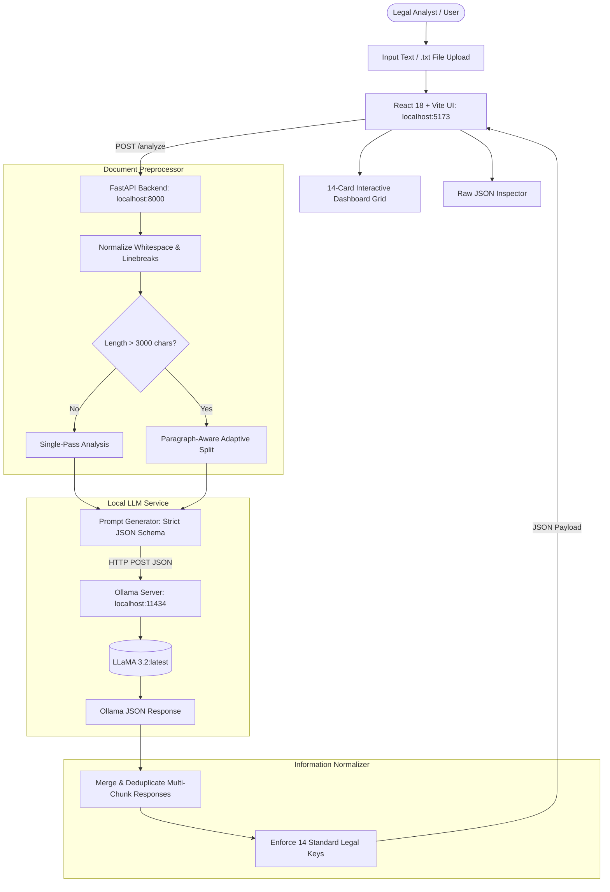

# ⚖️ Automated Legal Document Analyzer (gpt_exp5)

[](https://www.python.org/)
[](https://fastapi.tiangolo.com/)
[](https://react.dev/)
[](https://vitejs.dev/)
[](https://ollama.ai/)
[](LICENSE)

An automated, on-premise **Legal Document Analysis & Information Extraction System** built with **FastAPI**, **React.js (Vite)**, and a local **Ollama** LLM running **Llama 3.2**.

> **Zero Cloud Dependency & Complete Data Privacy**: Replaces commercial cloud APIs with local Ollama (`llama3.2:latest`). Runs 100% locally with zero cloud API keys, zero external network dependency, zero subscription costs, and guaranteed legal document confidentiality.

---

## 📌 Table of Contents

- [Overview](#-overview)
- [Key Features](#-key-features)
- [System Architecture & Workflow](#-system-architecture--workflow)
- [Technology Stack](#-technology-stack)
- [Project Structure](#-project-structure)
- [Prerequisites](#-prerequisites)
- [Step-by-Step Execution Guide](#-step-by-step-execution-guide)
  - [Step 1: Start and Verify Ollama](#step-1-start-and-verify-ollama)
  - [Step 2: Start the FastAPI Backend](#step-2-start-the-fastapi-backend)
  - [Step 3: Start the React Frontend](#step-3-start-the-react-frontend)
- [Testing with the Sample Document](#-testing-with-the-sample-document)
- [How the System Works](#-how-the-system-works)
- [REST API Reference](#-rest-api-reference)
- [Troubleshooting](#-troubleshooting)
- [License](#-license)

---

## 🌟 Overview

Legal contracts and business agreements are dense, lengthy, and filled with boilerplate language. Extracting core terms, identifying rights and obligations, and detecting risk factors manually is labor-intensive and prone to human error.

The **Automated Legal Document Analyzer** automates contract review:
- **Instant Ingestion**: Paste raw legal text or upload `.txt` files directly.
- **14 Structured Legal Categories**: Automatically categorizes key contract elements into clean, actionable data cards.
- **Local & Confidential**: Sensitive legal text never leaves your workstation or company intranet.

---

## 🚀 Key Features

| Capability | Description |
| :--- | :--- |
| **📑 Document Classification** | Identifies the exact document type (e.g., Employment Agreement, NDA, Service SLA, Lease). |
| **👥 Party Identification** | Pinpoints all contracting parties, employers, contractors, and corporate entities. |
| **🎯 Objective & Purpose** | Clearly extracts the stated commercial objective and operational scope. |
| **⚖️ Rights & Obligations** | Delineates affirmative duties, restrictive covenants, and legal entitlements for each party. |
| **💰 Commercial Terms** | Extracts compensation, payment schedules, milestones, and currency details. |
| **⏳ Term & Termination** | Identifies start dates, contractual duration, notice periods, and termination triggers. |
| **🔒 Confidentiality & IP** | Isolates non-disclosure duties and intellectual property ownership clauses. |
| **⚠️ Risk & Critical Clauses** | Highlights governing law, liability provisions, indemnity, and high-risk terms. |
| **📝 Executive Summary** | Generates a clean, factual executive synopsis of the entire contract. |
| **🔍 Raw JSON Inspector** | Built-in modal inspector to inspect and copy raw API response payloads. |

---

## 🏗️ System Architecture & Workflow



---

## 🛠️ Technology Stack

| Layer | Technology | Purpose |
| :--- | :--- | :--- |
| **Frontend** | React 18, Vite, Vanilla CSS, Lucide Icons | High-performance, responsive single-page application |
| **Backend** | Python 3.11+, FastAPI, Uvicorn, Pydantic | Asynchronous REST API, CORS middleware, schema validation |
| **LLM Inference** | Ollama (`llama3.2:latest`) | Local deterministic JSON contract information extraction |
| **Communication** | HTTP REST (Zero Cloud APIs) | Local IPC (`:5173` $\rightarrow$ `:8000` $\rightarrow$ `:11434`) |

---

## 📁 Project Structure

```
gpt_exp5/
├── backend/
│   ├── main.py                   # FastAPI REST API server & CORS configuration
│   ├── ollama_service.py         # Ollama HTTP client, prompt formulation, JSON normalizer
│   ├── document_processor.py     # Preprocessing, length validation, paragraph chunker
│   ├── requirements.txt          # Python backend dependencies
│   └── sample_document.txt       # Lab test Employment Agreement
│
├── frontend/
│   ├── src/
│   │   ├── components/
│   │   │   ├── Header.jsx          # Header with lab title and security badges
│   │   │   ├── DocumentInput.jsx   # Textarea, file uploader, sample button
│   │   │   ├── AnalysisResult.jsx  # 14 distinct structured analysis cards
│   │   │   └── RawJsonModal.jsx    # Raw JSON payload inspector
│   │   ├── App.jsx                 # Root application state & coordination
│   │   ├── index.css               # Clean, modern Vanilla CSS design system
│   │   └── main.jsx                # React DOM entry point
│   ├── index.html                # Web page shell with typography links
│   ├── vite.config.js            # Vite bundler configuration
│   ├── package.json              # Frontend scripts & dependencies
│   └── package-lock.json         # Pinned npm dependencies
│
├── architecture_diagram.jpg      # Visual system architecture diagram
├── .gitignore                    # Git ignore rules
├── LICENSE                       # MIT Open Source License
└── README.md                     # Project documentation & manual
```

---

## ⚙️ Prerequisites

1. **Python 3.10+** installed on your workstation.
2. **Node.js 18+** and **npm** installed.
3. **Ollama**:
   - Download and install Ollama from [ollama.com](https://ollama.com/).
   - Ensure the daemon is running locally (`http://localhost:11434`).

---

## 🚀 Step-by-Step Execution Guide

### Step 1: Start and Verify Ollama

1. Start the Ollama background engine:
   ```bash
   ollama serve
   ```
2. Verify installed models:
   ```bash
   ollama list
   ```
3. Pull `llama3.2:latest` (or `llama3.2`):
   ```bash
   ollama pull llama3.2:latest
   ```

---

### Step 2: Start the FastAPI Backend

1. Navigate to the `backend` directory:
   ```bash
   cd backend
   ```
2. Create and activate a Python virtual environment:
   - **Windows (PowerShell):**
     ```powershell
     python -m venv venv
     .\venv\Scripts\Activate.ps1
     ```
   - **Linux / macOS:**
     ```bash
     python3 -m venv venv
     source venv/bin/activate
     ```
3. Install required packages:
   ```bash
   pip install -r requirements.txt
   ```
4. Start the backend server:
   ```bash
   uvicorn main:app --reload --port 8000
   ```
   *The backend will be running at `http://127.0.0.1:8000` (Swagger UI at `http://127.0.0.1:8000/docs`).*

---

### Step 3: Start the React Frontend

1. Open a new terminal tab and navigate to the `frontend` directory:
   ```bash
   cd frontend
   ```
2. Install dependencies:
   ```bash
   npm install
   ```
3. Launch the Vite development server:
   ```bash
   npm run dev
   ```
4. Open your browser and navigate to: **`http://localhost:5173`**

---

## 🧪 Testing with the Sample Document

1. In the web dashboard, click **"Load Sample Agreement"**.
2. The standard test Employment Agreement will be populated into the input area:
   ```text
   EMPLOYMENT AGREEMENT

   This Employment Agreement is between ABC Technologies Pvt. Ltd. and John Smith.

   The employee will work as a Software Developer.

   The employment period is 12 months starting from 01-07-2026.

   The employee will receive a monthly salary of ₹50,000.

   The employee must maintain confidentiality regarding company information.

   The employee must perform assigned duties and follow company policies.

   Either party may terminate the agreement by providing 30 days written notice.

   Any intellectual property created during employment belongs to the company.

   The agreement is governed by the applicable laws of India.
   ```
3. Click **"Analyze Document"**.
4. Review the 14 extracted legal category cards:
   - **Document Type**: Employment Agreement
   - **Parties**: ABC Technologies Pvt. Ltd., John Smith
   - **Purpose**: Software Developer employment
   - **Obligations**: Maintain confidentiality, perform assigned duties, follow policies
   - **Rights**: 30 days written notice for termination
   - **Payment Terms**: ₹50,000 monthly salary
   - **Duration**: 12 months (starting 01-07-2026)
   - **Termination**: 30 days written notice by either party
   - **Confidentiality**: Must maintain confidentiality regarding company information
   - **Important Dates**: 01-07-2026 (Start Date)
   - **Governing Law**: Laws of India
   - **Key Clauses**: Intellectual property assignment, notice period
   - **Potentially Important Clauses**: Intellectual property ownership by employer
   - **Summary**: Comprehensive factual synthesis

---

## 🧠 How the System Works

1. **Document Ingestion**:
   Accepts legal contract text via manual paste or `.txt` file upload.
2. **Text Normalization**:
   Strips redundant whitespace, normalizes carriage returns, and validates input length.
3. **Adaptive Chunking**:
   - Contracts under ~3,000 characters are processed directly in a single pass.
   - Longer agreements are chunked along paragraph boundaries to maintain semantic integrity.
4. **Constrained Prompting**:
   Adopts a legal expert role, enforces strict factual extraction without extrapolation, and mandates structured JSON mode.
5. **Ollama JSON Mode**:
   FastAPI calls `/api/generate` with `"format": "json"`, ensuring 100% syntactically valid JSON responses.
6. **Merging & Deduplication**:
   Merges multi-chunk results, removes duplicates across party/obligation lists, and validates presence of all 14 schema keys.
7. **Interactive UI Rendering**:
   Organizes results into color-coded cards, risk alerts, and export options.

---

## 📡 REST API Reference

### `GET /health`
Checks backend connectivity and local Ollama status.

**Response:**
```json
{
  "status": "ok",
  "ollama": true,
  "model": "llama3.2:latest",
  "model_available": true,
  "available_models": ["llama3.2:latest"],
  "pull_command": null,
  "message": "Ollama is running and ready."
}
```

### `GET /sample`
Retrieves the standard sample Employment Agreement.

### `POST /analyze`
Analyzes document text and returns structured legal categories.

**Request Body:**
```json
{
  "document_text": "EMPLOYMENT AGREEMENT\nThis Employment Agreement is between ABC Technologies Pvt. Ltd. and John Smith...",
  "model_name": "llama3.2:latest"
}
```

**Response Body:**
```json
{
  "success": true,
  "analysis": {
    "document_type": "Employment Agreement",
    "parties": ["ABC Technologies Pvt. Ltd.", "John Smith"],
    "purpose": "Employment as Software Developer",
    "obligations": ["Maintain confidentiality", "Perform assigned duties"],
    "rights": ["30 days notice for termination"],
    "payment_terms": "₹50,000 per month",
    "duration": "12 months starting from 01-07-2026",
    "termination": "30 days written notice by either party",
    "confidentiality": "Must maintain confidentiality regarding company information",
    "important_dates": ["01-07-2026"],
    "governing_law": "Laws of India",
    "key_clauses": ["Intellectual property ownership", "Confidentiality"],
    "potentially_important_clauses": ["All intellectual property belongs to the company"],
    "summary": "This is a 12-month employment agreement between ABC Technologies and John Smith..."
  },
  "metadata": {
    "character_count": 524,
    "word_count": 82,
    "is_chunked": false,
    "chunk_count": 1
  }
}
```

---

## ❓ Troubleshooting

| Issue | Cause | Solution |
| :--- | :--- | :--- |
| `Cannot connect to Ollama` | Ollama daemon is not running. | Run `ollama serve` in a terminal. |
| `Model llama3.2:latest not found` | The model has not been downloaded. | Run `ollama pull llama3.2:latest`. |
| `CORS error in browser` | Backend is not running on port 8000. | Check `main.py` is running on `http://127.0.0.1:8000`. |
| `Network error in frontend` | Backend server is offline. | Start FastAPI with `uvicorn main:app --reload --port 8000`. |

---

## 📄 License

This project is licensed under the [MIT License](LICENSE).
